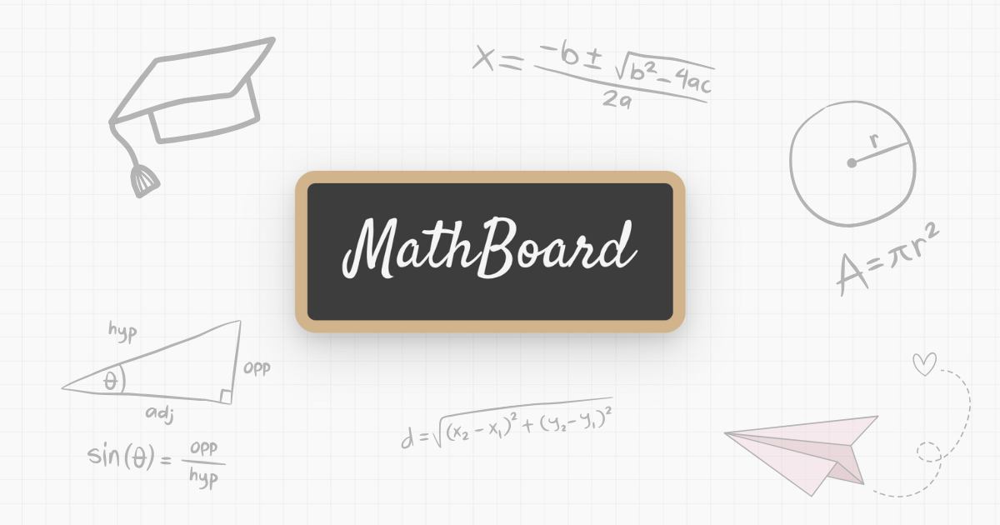

<p align="center">
  <a href="https://mathboard.app/">
    
  </a>
</p>

<h1 align="center">MathBoard</h1>

<p align="center">
  <strong>An open-source, math-first whiteboard for teachers and tutors.</strong><br>
  Draw freely. Write editable LaTeX. Teach visually.
</p>

<p align="center">
  <a href="https://mathboard.app/">Launch MathBoard</a> ·
  <a href="https://mathboard.app/download/">Desktop beta</a> ·
  <a href="#key-features">Features</a> ·
  <a href="#getting-started">Get started</a> ·
  <a href="#documentation">Documentation</a> ·
  <a href="CONTRIBUTING.md">Contribute</a>
</p>

<p align="center">
  <a href="https://github.com/giacomobartoloni/mathboard/actions/workflows/main.yml">
    
  </a>
  <a href="LICENSE.md">
    
  </a>
  <a href="https://mathboard.app/">
    
  </a>
  <a href="https://mathboard.app/download/">
    
  </a>
</p>

MathBoard is an innovative digital whiteboard application specifically designed for math teachers. It seamlessly combines freehand drawing capabilities with powerful LaTeX formula support, enabling users to create, edit, and organize mathematical content with unprecedented ease.

## Key Features

- **Freehand Drawing**: Intuitive drawing tools for sketching mathematical diagrams and graphs
- **LaTeX Formula Support**: Full LaTeX integration for professional mathematical notation
- **Interactive Canvas**: Zoom, pan, and organize your mathematical content
- **User-Friendly Interface**: Clean, modern design optimized for mathematical work

## Who Is It For?

MathBoard is specifically crafted for:
- **Educators**: Teaching mathematics and conducting online lessons
- **Students**: Taking notes and solving mathematical problems
- **Professionals**: Creating technical documentation and presentations
- **Researchers**: Developing and communicating mathematical concepts

## Getting Started

### Project setup

Install dependencies from the lockfile:
```
npm ci
```

For end-to-end tests, also install the Playwright Chromium browser once after `npm ci` (or after upgrading `@playwright/test`):
```
npm run test:e2e:install
```

### Compiles and hot-reloads for development
```
npm run dev
```

### Compiles and minifies for production
```
npm run build
```

The production build is written to `dist/`, the static asset directory Cloudflare serves (see `wrangler.json`).

### Lints files
```
npm run lint
```

Reports lint errors without modifying files.

### Unit / module tests
```
npm run test:unit
```

Runs the `node:test` suite under `tests/`.

### End-to-end tests (Chromium)
```
npm run test:e2e
```

Builds the app with `vite build --mode e2e --outDir dist-e2e` (read-only `window.__MATHBOARD_E2E__` hook in a separate artifact from production `dist/`), then runs the Playwright P0 suite against `vite preview` on that directory. Use `npm run test:e2e:ui` for the Playwright UI. CI installs Chromium with `npx playwright install --with-deps chromium`.

### Regenerates PWA icons
```
npm run generate:icons
```

Renders `tools/icon-template.html` in headless Chromium and overwrites `public/icon-192x192.png` and `public/icon-512x512.png`. Needs network access: Puppeteer downloads Chrome when the package is installed, and the generator loads Satisfy from Google Fonts. It aborts if that font does not load.

### Preview production build
```
npm run preview
```

`npm run build` runs the Vite app build, then `tools/build-seo.mjs`, which writes static resource/docs pages into `dist/` and regenerates `sitemap.xml` plus `404.html`.

## Documentation

- [Download MathBoard Desktop](https://mathboard.app/download/) — macOS, Windows and Linux unsigned public beta installers hosted on official GitHub Releases.
- [Install MathBoard with Homebrew](https://mathboard.app/download/macos/#homebrew) — macOS setup via the [official MathBoard Homebrew tap](https://github.com/giacomobartoloni/homebrew-tap), including Gatekeeper guidance.
- [Desktop installation and security](https://mathboard.app/download/security/) — checksums, unsigned-binary limitations and platform guides.
- [MathBoard resources](https://mathboard.app/resources/)
- [LaTeX formulas](https://mathboard.app/docs/latex/)
- [Keyboard shortcuts](https://mathboard.app/docs/keyboard-shortcuts/)

## License

This project is licensed under the GNU Affero General Public License v3.0 - see the [LICENSE](LICENSE.md) file for details.

---

Built by [Giacomo Bartoloni](https://github.com/giacomobartoloni) · [LinkedIn](https://www.linkedin.com/in/giacomobartoloni/) · [Contribute](CONTRIBUTING.md)
