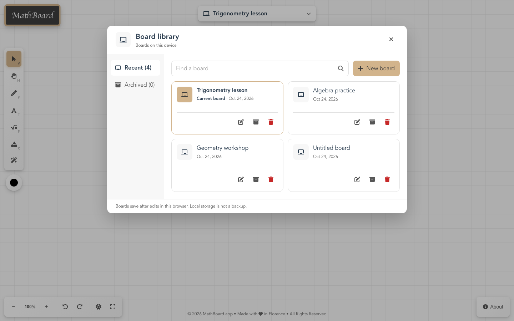
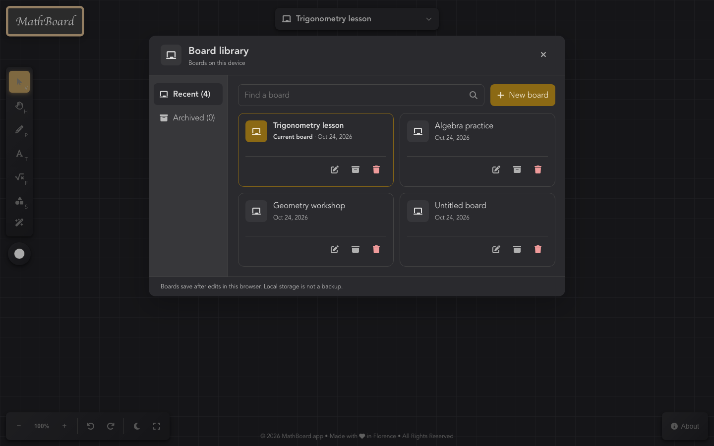
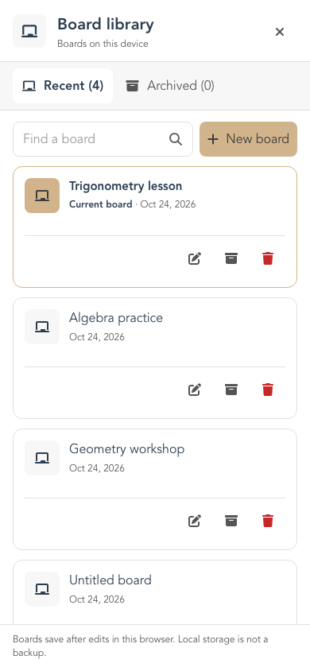
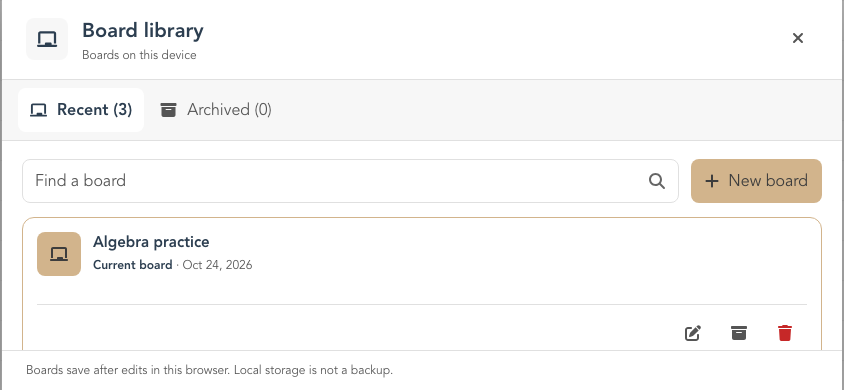

# Board library overview

This branch explores a broader board browser in place of the compact picker. The current board remains named at the top center. Opening it reveals Recent and Archived navigation, search, and a two-column grid of board cards on desktop. Each card exposes Rename, Archive/Unarchive, and Delete directly; its board icon and title open the board.

| Desktop, light | Desktop, dark |
| --- | --- |
|  |  |

| Phone | Short landscape viewport |
| --- | --- |
|  |  |

Search filters the selected view. **New board** opens a separate title field, so a search query never becomes a board name by accident. The footer states that boards are stored in this browser and are not backed up. Cards show real titles, dates, and current-board state; they do not imply a saved canvas preview.

The composition takes cues from [Miro's recent-board and browse views](https://help.miro.com/hc/en-us/articles/360017571294-Home-page) and [Figma's file browser](https://help.figma.com/hc/en-us/articles/14381406380183-Guide-to-the-file-browser). MathBoard keeps its local-only board model and existing visual tokens.
